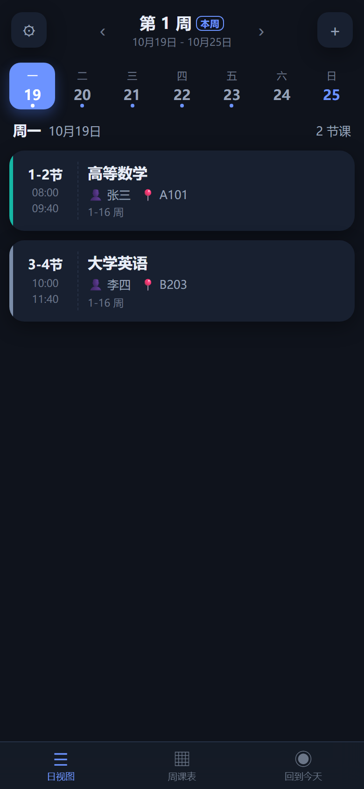
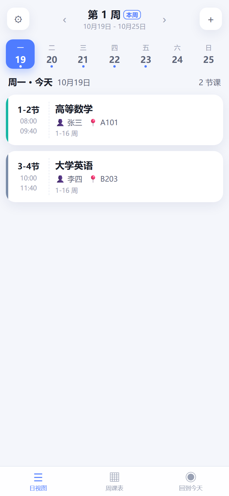
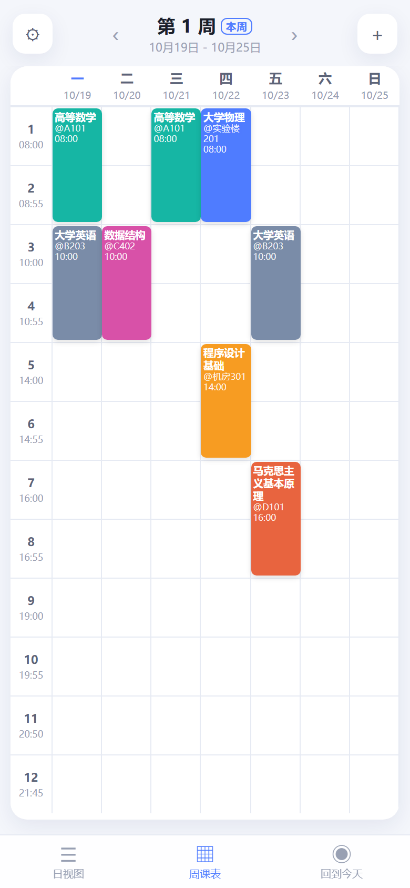
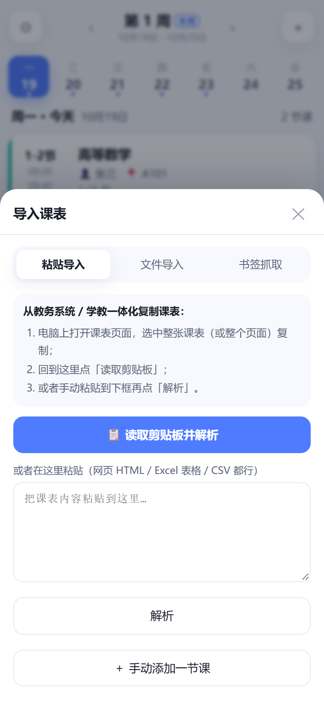
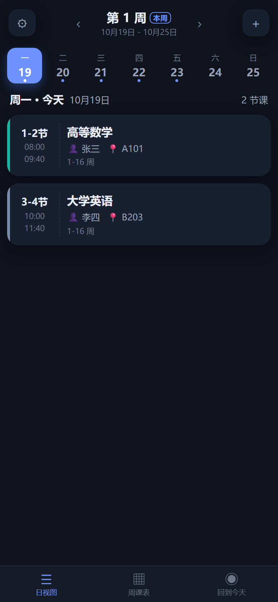

# 课程表 · 自用版

一个装在自己手机上的课程表 App。**不用登录、不上传数据**，课表从「学教一体化」/ 教务系统的课表页面导进来，离线也能看。

## 0. 线上地址（已部署 ✅）

> **https://fybr031.github.io/coursetable/**
>
> 手机浏览器打开这个网址 → 菜单「**添加到主屏幕**」→ 桌面上就有图标了，之后断网也能用。
> 仓库：<https://github.com/fybr031/coursetable>（公开仓库；页面上没有你的任何课表数据）

改完代码要更新线上版本：在 `D:\CourseTable` 下执行

```powershell
powershell -ExecutionPolicy Bypass -File tools\deploy-pages.ps1
```

（令牌从 `D:\DSH-data\secrets\gh-token.txt` 读取，不会打印。部署完 Pages 一般 1 分钟内生效；手机端因为 Service Worker 缓存，**可能要打开两次才看到新版**。）



| 日视图（浅色） | 周课表 | 导入课表 | 深色模式 |
| --- | --- | --- | --- |
|  |  |  |  |

---

## 1. 功能

- **日视图**：今天/选中那天的课，按节次排好，显示时间、教师、教室、周次；正在上的课高亮「进行中」。
- **周课表**：一屏放下周一到周日 + 12 节课，左右滑动切天，点课程看详情。
- **周次管理**：设定「第 1 周的周一」和总周数，自动算出「现在是第几周」；单双周、指定周次范围都支持。
- **导课**（重点，见第 4 节）：网页表格 / Excel 复制 / CSV / HTML 文件 / 书签一键抓取 / 手动录入。
- **可编辑**：课程随便改，教师、教室、周次、备注都能改；课表颜色按课程名自动分配。
- **离线可用**：PWA，装到主屏幕后断网也能开（用局域网 http 访问时离线缓存不生效，见第 3 节）。
- **数据自持**：只存在浏览器本地，支持导出 JSON 备份，换手机直接导入。
- 深色模式自动跟随系统；适配刘海屏安全区。

## 2. 目录结构

```
CourseTable/
├─ index.html              # App 主页面（PWA 入口）
├─ manifest.webmanifest    # PWA 清单（图标、名称、全屏模式）
├─ sw.js                   # Service Worker（离线缓存，需 https 或 localhost）
├─ 启动课程表.bat           # 双击：起本地服务并打开浏览器
├─ assets/
│  ├─ app.css              # 样式（含深色模式）
│  ├─ app.js               # 逻辑（视图、存储、导入导出、设置）
│  ├─ parser.js            # 课表解析引擎（HTML 表格 / TSV / CSV / 纯文本）
│  └─ icons/               # 生成的图标
├─ dist/课程表.html         # ★ 单文件版（CSS/JS 全内联，90 多 KB，可直接发手机）
├─ tools/
│  ├─ serve.mjs            # 局域网静态服务器（手机同 WiFi 可访问）
│  ├─ build.mjs            # 生成单文件版
│  ├─ make-icons.mjs       # 生成图标（零依赖 PNG 编码）
│  └─ screenshot.mjs       # 开发用：CDP 手机视口截图
├─ tests/
│  ├─ parser.test.mjs      # 解析引擎单测（node tests/parser.test.mjs）
│  └─ e2e.html             # 端到端测试页（浏览器里跑，27 项断言）
└─ docs/screenshots/       # 截图
```

## 3. 怎么跑起来

### 电脑上看看

- 双击 **`启动课程表.bat`** → 自动打开 `http://localhost:8080/`。
- 或者直接双击 `index.html`（部分浏览器对 `file://` 有本地存储限制，见常见问题）。
- 单文件版：双击 `dist\课程表.html` 也行。

第一次打开是空课表，可以点「**先看示例课表**」看效果，再点右上角 **＋** 导入自己的。

### 手机上用（已用方式 A 部署好，直接用即可）

| 方式 | 做法 | 说明 |
| --- | --- | --- |
| **A. GitHub Pages（✅ 已部署）** | 手机打开 <https://fybr031.github.io/coursetable/> → 菜单「添加到主屏幕」 | 有图标、能离线、电脑关着也能用。更新方式见第 0 节。 |
| **B. 局域网（电脑得开着）** | 电脑双击 `启动课程表.bat`，把打印出来的 `http://192.168.x.x:8080/` 在手机浏览器打开（同一个 WiFi）。 | 适合快速预览/调试；http 不是「安全上下文」，装不上图标、离线缓存不生效（功能都正常）。 |
| **C. 单文件版** | 把 `dist\课程表.html` 发到微信「文件传输助手」，手机上用浏览器打开。 | 完全不依赖网络和电脑；缺点：部分手机浏览器对本地文件限制本地存储，可能关掉页面丢数据——用设置里的「导出备份」兜底。 |

> 想要安卓 APK 再说（代码已经是标准 PWA，套壳即可）。

## 4. 怎么把课表导进来（核心）

原理：不依赖某个学校的具体接口，而是**把课表页面本身读下来解析**。所以「学教一体化」还是别的教务系统都能用。

### 方式 ① 书签一键抓取（桌面浏览器，最省事）

1. App 里点 **＋ → 书签抓取**，复制那段 `javascript:...` 代码；
2. 在电脑浏览器新建书签，把代码粘进「网址」栏保存；
3. 打开课表页面，点这个书签 —— 它会自动找到课表表格并复制到剪贴板；
4. 回 App 点 **＋ → 粘贴导入 → 读取剪贴板并解析** → 核对 → 「替换全部」。

### 方式 ② 网页另存为 HTML（最稳）

1. 电脑上打开课表页面，`Ctrl+S` → 保存类型选「**网页，仅 HTML**」；
2. 把文件传到手机（微信/QQ/网盘），App 里 **＋ → 文件导入 → 选择文件**。

> 电脑上更简单：直接在 App 里 **粘贴导入** —— 在课表页 `Ctrl+A`、`Ctrl+C` 复制整页，回到 App 粘进文本框点「解析」。复制的富文本里带 HTML，解析质量一样好。

### 方式 ③ Excel / CSV

在 Excel 里选中课表区域 `Ctrl+C`，App 里粘贴（走剪贴板表格通道）；
或者把 `.csv` 文件用「文件导入」。**注意**：`.xlsx` 不能直接导入，先在 Excel 里复制粘贴。

### 方式 ④ 手动

课少或者想改几节，**＋ → 手动添加一节课**（也可以点已有课程 → 编辑）。

### 解析器的识别规则（出问题看这里）

- 找表头：一行里出现 **≥2 个「周一/星期一/礼拜一…」** 才认为这是课表，然后按列对应星期。
- 左/上侧的「第1-2节 / 1 / 上午」等列当节次，`rowspan` 合并单元格会自动展开。
- 单元格里按行/空格拆：第一行=课程名，含数字的当教室，2–4 个汉字当教师；`1-16周`、`1-8周(单)`、`1-8,10-16周` 都能识别。
- 解析完**一定会先给你预览**，确认无误再「替换全部/追加合并」，别直接信。

若识别不准：优先用「网页另存为 HTML」（结构最完整）；再不行就手动补几节，或者把识别错的课表 HTML 发我调规则。

## 5. 学期与周次设置

点左上角 **⚙**：

- **第 1 周的周一**：决定「本周是第几周」。默认取打开 App 那周的周一；开学后改成实际开学那周的周一即可。
- **学期总周数**：默认 20，可改 1–40。
- **每节课时间**：默认 12 节（8:00 开始），按学校作息改，影响日/周视图里显示的时间。

## 6. 数据与备份

- 数据存在浏览器的 `localStorage`（键名 `coursetable.v1`），**不联网、不上传**。
- **备份**：⚙ → 「导出」下载 `课程表备份-日期.json`；或「复制备份到剪贴板」发给自己微信收藏。
- **恢复**：App 里 **＋ → 文件导入** 选那个 `.json`（或粘贴 JSON 内容）→ 「替换全部」。
- 换浏览器/清缓存/换手机 = 数据会没，**改完课表记得偶尔导一次备份**。

## 7. 常见问题

**Q：`Ctrl+A` 复制整页，粘贴后没识别出来？**
A：可能课表在 `iframe` 里（另存为 HTML 也一样）。这种情况用书签抓取，或在浏览器 F12 里选中课表所在的 frame 复制。

**Q：手机上点「读取剪贴板」没反应？**
A：`navigator.clipboard.read()` 需要 https + 用户授权，http 局域网下会被拒。改用「文件导入」或手动在文本框里长按粘贴。

**Q：课程时间对不上？**
A：⚙ 里改「每节课时间」；节次号本身来自课表，不用改。

**Q：单双周识别成每周了？**
A：点课程 → 编辑 → 周次选「指定周次范围」+ 单/双周。

**Q：周课表里某天课程显示不全/重叠？**
A：同一节次有两门课会叠在一起（很少见），点进去能分别看到；也可以点编辑挪一下节次。

**Q：数据存哪儿了？会不会被清？**
A：浏览器本地。清浏览器数据/换设备会丢，用备份文件恢复。App 里如果提示「禁止本地存储」，说明当前打开方式（如某些本地文件模式）不支持，请改用 http 访问或导出备份。

## 8. 开发 / 维护

```bash
# 解析引擎单测（8 组，覆盖 rowspan、单双周、TSV、容错）
node tests/parser.test.mjs

# 重新生成单文件版 dist/课程表.html
node tools/build.mjs

# 重新生成图标
node tools/make-icons.mjs

# 本地起服务（手机同 WiFi 可用）
node tools/serve.mjs 8080

# 端到端测试：起服务后浏览器打开
#   http://localhost:8080/tests/e2e.html     （27 项断言，看页面输出）
```

改了 `assets/` 里的文件后记得跑一次 `node tools/build.mjs`，否则 `dist/课程表.html` 还是旧的。

版本 v1.0.0
